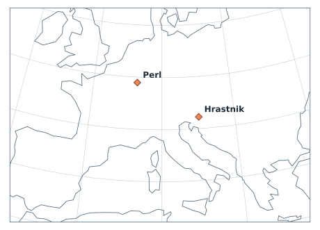
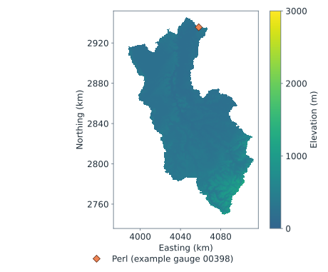
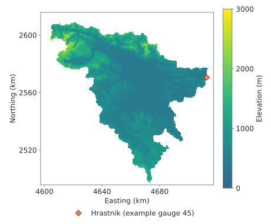

# Example domains <!--! {#testbasin} -->

<!--! [TOC] -->

The repository includes two runnable catchments. The Moselle at Perl is in
`examples/domain_01` and the Sava at Hrastnik is in `examples/domain_02`.
They can run individually or together, as shown in the [build and run guide](v6-getting-started.md).

<!--!
\cond
-->
<picture>
  <source media="(prefers-color-scheme: dark)" srcset="figures/example-basins-location-dark.svg">
  
</picture>
<!--!
\endcond
\htmlonly

Example outlets at Perl and Hrastnik in Europe

\endhtmlonly
\image latex example-basins-location.pdf "Example outlets at Perl and Hrastnik in Europe" width=10cm
-->

The outlet markers come from the example gauge grids. Coastlines are from
[Natural Earth](https://www.naturalearthdata.com/).

## Moselle at Perl

The Moselle rises in the Vosges Mountains and flows into the Rhine. The example
covers the catchment upstream of Perl near the border of France, Luxembourg,
and Germany. The catchment is approximately 11,500 km2. The shipped
500 m elevation grid ranges from 186 to 1,284 m above sea level over its active
cells. The Perl outlet is gauge `00398` in the example data.

<!--!
\cond
-->
<picture>
  <source media="(prefers-color-scheme: dark)" srcset="figures/moselle-example-elevation-dark.svg">
  
</picture>
<!--!
\endcond
\htmlonly

Elevation of active cells in the Moselle morphology grid

\endhtmlonly
\image latex moselle-example-elevation.pdf "Elevation of active cells in the Moselle morphology grid" width=10cm
-->

## Sava at Hrastnik

The second example covers the Sava upstream of Hrastnik in Slovenia, a drainage
area of about 5,200 km2. It was added to exercise runs with multiple domains
and spatial scales. The shipped 500 m elevation grid ranges from 394 to
2,735 m above sea level over its active cells. The example labels Hrastnik as
gauge `45`. The Slovenian Environment Agency lists the station as `3725`.
[Slovenian Environment Agency station data](https://www.arso.gov.si/vode/podatki/Povratne%20dobe%20Qvk%2CQnp.pdf)

<!--!
\cond
-->
<picture>
  <source media="(prefers-color-scheme: dark)" srcset="figures/sava-example-elevation-dark.svg">
  
</picture>
<!--!
\endcond
\htmlonly

Elevation of active cells in the Sava morphology grid

\endhtmlonly
\image latex sava-example-elevation.pdf "Elevation of active cells in the Sava morphology grid" width=10cm
-->

## Shipped configurations

Both default runs use an hourly model step and 24 km hydrology (Level 1)
and routing (Level 3) grids. The Level 0 morphology grids and the daily
precipitation, mean temperature, and potential evapotranspiration inputs
are supplied with each example.

The maps use the example grids in ETRS89 / LAEA Europe (EPSG:3035). The
auxiliary latitude and longitude in the morphology and meteorological files
describe the same cell centers as the projected axes.

| Setting | Moselle | Sava |
| --- | --- | --- |
| Directory | `examples/domain_01` | `examples/domain_02` |
| Active Level 0 cells | 46,545 | 21,025 |
| Simulation start | 1990-01-01 | 1992-07-05 |
| Evaluation start | 1990-01-01 | 1993-01-01 |
| Simulation end | 1994-01-01 00:00 | 1994-01-01 00:00 |
| Supplied outlet discharge record | 1990-01-01 to 1993-12-31 | 1993-03-01 to 2009-12-31 |

The dates come from each example's `mhm.nml`. The supplied daily discharge
records are in `input/gauge/`. For configuration options, see
[time settings](nml/config_time.md) and [grid resolution settings](nml/config_resolution.md).

In the optional Moselle soil-moisture file (`input/optional/sm.nc`), the
`sm` field uses the Moselle 24 km grid. Its geographic coordinates are
`lon` and `lat`, with projected axes `x` and `y`.

## Data acknowledgments

These credits were recorded for the Moselle example. See the
[example data terms in the license](../LICENSE.md#redistribution-of-example-data)
for usage and redistribution conditions. The shipped Sava files do not
identify the original providers for all inputs.

### Daily temperature and precipitation

E-OBS from the EU-FP6 ENSEMBLES project and the data providers in ECA&D.
[Haylock et al. (2008)](https://doi.org/10.1029/2008JD010201)

### Discharge observations

Global Runoff Data Centre (GRDC).

### Elevation

Shuttle Radar Topography Mission (SRTM) data from the U.S. Geological Survey
EROS Center and NASA's LP DAAC.

### Soils

Harmonized World Soil Database from FAO, IIASA, ISRIC, ISSCAS, and the
European Commission's Joint Research Centre.

### Geologic classes

European Soil Database from the European Commission.

### Land cover

CORINE Land Cover from the European Environment Agency.
