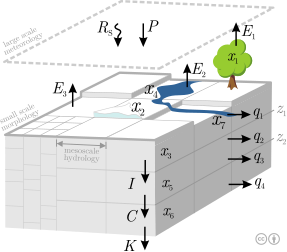
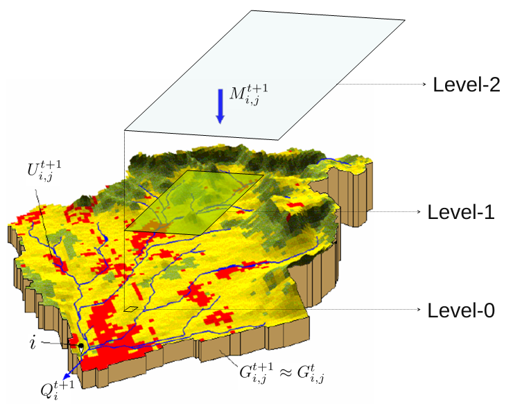
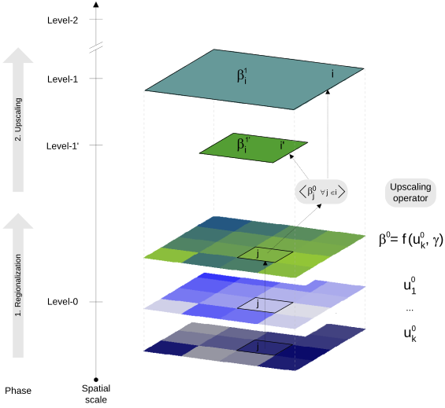

# Introduction to mHM <!--! {#model_overview} -->

<!--! [TOC] -->

<!--!
\cond
-->

<!--!
\endcond
\image html mHM_textlogo.png
-->

<a name="description"></a>

## Short Description

This document describes the source code for the mesoscale Hydrologic
Model mHM.  mHM is based on accepted hydrological conceptualizations
and is able to reproduce as accurately as possible not only observed
discharge hydrographs at any point within a basin but also the
distribution of soil moisture among other state variables and
fluxes. To achieve these goals and to ensure a reliable performance in
ungauged basins, this model employs a multiscale parameter
regionalization technique to obtain effective at the scale of
interest.

This model is driven by daily or hourly precipitation, temperature
fields that are acquired either from satellite products or from
observation networks. In the latter case, the driving meteorological
data has to be prepared in advance. A module for external drift
Kriging is available upon request.

<a name="mHM"></a>

## The Grid-based mHM Model

The mHM hydrologic model is based on numerical approximations of
dominant hydrological processes that have been tested in various
models: HBV \cite Bergstroem1976, \cite HB2004, \cite BRK2008 and VIC
\cite LLW1994 . This model includes also a number of new features that
will be described in the next section. In general, this model
simulates the following processes: canopy interception, snow
accumulation and melting, soil moisture dynamics, infiltration and
surface runoff, evapotranspiration, subsurface storage and discharge
generation, deep percolation and baseflow, and discharge attenuation
and flood routing ([mHM](#fig_mhm)). More information about the model
can be found in
\cite SKA2010 .

<a name="fig_mhm"></a>

<!--!
\cond
-->
<picture>
  <source media="(prefers-color-scheme: dark)" srcset="figures/logo/mhm5-logo-dark.svg">
  
</picture>
<!--!
\endcond
\htmlonly
<div class="image">

<div class="caption">Typical mHM cell</div>
</div>
\endhtmlonly
\image latex mhm5-logo.pdf "Typical mHM cell" width=10cm
-->


Dominant processes of the hydrological cycle at mesoscale span over
several orders of magnitude \cite BS1995 . In this model, three
levels ([mHM levels](#fig_levels)) will be differentiated to better
represent the spatial variability of state and inputs variables:

- *Level-0*: Spatial discretization suitable to
      describe the main features of the terrain, the main soil
      characteristics (pedotop), and the land cover. The cell
      size at this level is denoted by $\ell_0$.

- *Level-1*: Spatial discretization used to
      describe dominant hydrological processes
      \cite Bloeschl2001 at the mesoscale as well as the main
      geological formations of the basin. The cell size at this
      level is denoted by $\ell_1$.

- *Level-2*: Spatial discretization suitable to
      describe the variability of the meteorological forcings at
      the mesoscale, for example the formation of convective
      precipitation. The cell size at this level is denoted by
      $\ell_2$.

<a name="fig_levels"></a>

<!--!
\cond
-->
<picture>
  <source media="(prefers-color-scheme: dark)" srcset="figures/levels-dark.svg">
  
</picture>
<!--!
\endcond
\htmlonly
<div class="image">

<div class="caption">Hierarchy of data and modeling levels in mHM</div>
</div>
\endhtmlonly
\image latex levels.pdf "Hierarchy of data and modeling levels in mHM" width=10cm
-->


<a name="model"></a>

## Model Formulation

A mesoscale basin is an open natural system, composed of very
heterogeneous materials and having fuzzy boundary conditions. The
continuity assumption of the the input variables is quite difficult
to justify considering that the spatial heterogeneity of a basin is
mostly described by discrete attributes such soil texture types,
land cover classes, and geological formations. Due to these reasons,
a system of ordinary differential equations ODEs was adopted to
describe the evolution of the state variables at a given location
$i$ within the domain $\Omega$. This system of ODE is

$$
\begin{align*}
      \dot{x}_{1i}  &= P_i(t) - F_i(t) - E_{1i}(t)         \\
      \dot{x}_{2i}  &= S_i(t) - M_i(t)                     \\
      \dot{x}_{3i}^l  &= (1-\rho^l) I_i^{l-1}(t)  - E_{3i}^l(t) - I_i^l(t)\\
      \dot{x}_{4i}  &= \rho^1 \big(R_i(t) + M_i(t)\big) - E_{2i}(t) -  q_{1i}(t)\\
      \dot{x}_{5i}  &= I_i^L(t) - q_{2i}(t)- q_{3i}(t)- C_i(t)         \\
      \dot{x}_{6i}  &= C_i(t) - q_{4i}(t)         \\
      \dot{x}_{7i}  &= \hat{Q}_{i}^{0}(t)-\hat{Q}_{i}^{1}(t)
\end{align*}
$$

$\quad  \forall i \in \Omega$.

where

|**Variable**         |**Description**                        |
| ---------------------- | --------------------------------------------------------- |
| **Inputs** | |
|$P$                 | Daily precipitation depth,                $\mathrm{mm}\; \mathrm{d}^{-1}$ |
|$E_p$               | Daily potential evapotranspiration (PET), $\mathrm{mm}\; \mathrm{d}^{-1}$ |
|$T$                 | Daily mean air temperature,               $^{\circ}C$ |
| **Fluxes** | |
|$S$                 | Snow precipitation depth,                                    $\mathrm{mm}\; \mathrm{d}^{-1}$ |
|$R$                 | Rain precipitation depth,                                    $\mathrm{mm}\; \mathrm{d}^{-1}$ |
|$M$                 | Melting snow depth,                                          $\mathrm{mm}\; \mathrm{d}^{-1}$ |
|$E_p$               | Potential evapotranspiration,                                $\mathrm{mm}\; \mathrm{d}^{-1}$ |
|$F$                 | Throughfall,                                                 $\mathrm{mm}\; \mathrm{d}^{-1}$ |
|$E_1$               | Actual evaporation intensity from the canopy,                $\mathrm{mm}\; \mathrm{d}^{-1}$ |
|$E_2$               | Actual evapotranspiration intensity,                         $\mathrm{mm}\; \mathrm{d}^{-1}$ |
|$E_3$               | Actual evaporation from free-water bodies,                   $\mathrm{mm}\; \mathrm{d}^{-1}$ |
|$I$                 | Recharge, infiltration intensity or effective precipitation, $\mathrm{mm}\; \mathrm{d}^{-1}$ |
|$C$                 | Percolation,                                                 $\mathrm{mm}\; \mathrm{d}^{-1}$ |
|$q_{1}$             | Surface runoff from impervious areas,                        $\mathrm{mm}\; \mathrm{d}^{-1}$ |
|$q_{2}$             | Fast interflow,                                              $\mathrm{mm}\; \mathrm{d}^{-1}$ |
|$q_{3}$             | Slow interflow,                                              $\mathrm{mm}\; \mathrm{d}^{-1}$ |
|$q_{4}$             | Baseflow,                                                    $\mathrm{mm}\; \mathrm{d}^{-1}$ |
| **Outputs** | |
|$Q_{i}^{0}$         |  Simulated discharge entering the river stretch at cell $i$, $\mathrm{m}^3\;\mathrm{s}^{-1}$ |
|$Q_{i}^{1}$         |  Simulated discharge leaving the river stretch at cell  $i$, $\mathrm{m}^3\;\mathrm{s}^{-1}$ |
| **States** | |
|$x_1$               | Depth of the canopy storage,                                           $\mathrm{mm}$ |
|$x_2$               | Depth of the snowpack,                                                 $\mathrm{mm}$ |
|$x_3$               | Depth of soil moisture content in the root zone,                       $\mathrm{mm}$ |
|$x_4$               | Depth of impounded water in reservoirs, water bodies, or sealed areas, $\mathrm{mm}$ |
|$x_5$               | Depth of the water storage in the subsurface reservoir,                $\mathrm{mm}$ |
|$x_6$               | Depth of the water storage in the groundwater reservoir,               $\mathrm{mm}$ |
|$x_7$               | Depth of the water storage in the channel reservoir,                   $\mathrm{mm}$ |
| **Indices** | |
|$l$                 | Index denoting a root zone horizon, $l=1,\ldots,L$ (say $L=3$), in the first layer, $0 \leq z \leq z_1$ |
|$t$                 | Time index for each $\Delta t$ interval |
|$\rho^l$            | Overall influx fraction accounting for the impervious cover within a cell |


<a name="mpr"></a>

## The Multiscale Parameter Regionalization Technique

mHM requires at most 28  parameters (depending of the configuration)
per cell to account for the spatial variability of the dominant
hydrological processes at a mesoscale river basin. These *effective*
*parameters* have to be estimated through calibration. Calibrating
this model with a significant number of free parameters for every grid
cell would lead to over-parameterization in a mesoscale
catchment. This, in turn, would tend to increase the predictive
uncertainty of the model due to the *equifinality* \cite Beven1993
of feasible solutions. Moreover, the high dimensionality of this
optimization problem is also a daunting task for the state-of-the-art
optimization algorithms \cite PG2009 . To overcome this problem a
multiscale parameter regionalization (MPR) was employed in the mHM
model \cite SKA2010 .

<a name="fig_mpr"></a>

<!--!
\cond
-->
<picture>
  <source media="(prefers-color-scheme: dark)" srcset="figures/upscaling-dark.svg">
  
</picture>
<!--!
\endcond
\htmlonly
<div class="image">

<div class="caption">MPR</div>
</div>
\endhtmlonly
\image latex upscaling.pdf "MPR" width=10cm
-->

Based on this regionalization method, model parameters at a coarser
grid (Level-1) are linked with their corresponding ones at a finer
resolution (Level-0) ([MPR](#fig_mpr)). The linkage is done with upscaling
operators. Model parameters at the finer scale are, in turn,
regionalized with nonlinear transfer functions that couple catchment
descriptors with the global parameters. Process understanding and
empirical evidence are used to define these a priori
relationships. The general form of an upscaling operator
$\mathrm{O}$ is:

$$
  \beta_{ki}(t)=  \mathrm{O}_k \Big \langle \beta_{kj}(t) \quad \forall j \in i \Big \rangle_{i}
$$

where

$$
  \beta_{kj}(t)=  f_k \Big( u_j(t), \gamma  \Big).
$$

Here $k=1,\ldots,K$ with $K$ denoting the number of distributed model
parameters. $u_j$ denotes a $v$-dimensional predictor vector for
cell $j$ at level-0 which is contained by cell $i$ at level-1
(e.g. land cover, elevation, soil texture).

$\gamma$ is a $s$-dimensional vector of transfer
parameters(super parameters), with $s$ denoting the number of free
parameters to be calibrated or total degrees of freedom.
$\mathrm{O}_k \langle \bullet \rangle_{i}$ denotes the kind of
operator applied for the regionalization of the parameter $k$.
Several types of operators were employed, e.g. majority
$\mathcal{M}$, arithmetic mean $\mathcal{A}$, maximum difference
$\mathcal{D}$, geometric mean $\mathcal{G}$, and harmonic mean
$\mathcal{H}$. This table also shows the
type of relationship employed for the transfer function and the
predictors. By establishing such a relationships, the calibration
algorithm finds good solutions for the transfer functions parameters
($s=$ 45) instead of the model parameters for every grid cell. This,
in turn, implies a great reduction of complexity since $K \times n \gg s$, where $n$ denotes the total number of cells of a given basin
at level-1.

<a name="param_est"></a>

## The Parameter Estimation Problem

Let $\mathbf{M}\{\mathbf{f},\mathbf{g}\}$  be a dynamic, spatially
distributed, parameter efficient, integrated model that relates a
number of state variables $\mathbf{x}$ with some *observables*
called: inputs $\mathbf{u}$ and outputs $\mathbf{y}$. In general,
the system is described by the following system of equations

$$
\begin{align*}
 \dot{\mathbf{x}}(i,t) &=\mathbf{f}(\mathbf{x},\mathbf{u}, \beta, \gamma )(i,t) + \eta(i,t)\\
 \mathbf{y}(i,t)    &= \mathbf{g}(\mathbf{x}, \mathbf{u}, \beta, \gamma )_{\Omega} +  \epsilon(i,t)\\
\end{align*}
$$

where

- $\mathbf{f}$ is a system of functional relationships in mHM
      (continuous or discrete) that denote the evolution of the
      system over time.
- $\mathbf{g}$ is a vector of functional relationships
      used to quantify the expected output (e.g. runoff) of the model denoted
      by $\mathbf{\hat{y}}$.
- ${\epsilon}$ denotes the uncertainty of the system originated by
      defects on measurements of both the inputs and outputs.
- ${\eta}$ denotes the uncertainty originated by the simplification
      included during the formulation of $\mathbf{M}$ or due to
      the lack of knowledge of the relevant processes (i.e. any kind
      of model structure deficiency). This term is ignored
      in the present case.
- ${\beta}$ denotes the fields of effective mHM parameters at
  level-1 estimated as described in section ([MPR](#mpr)).
- $\gamma$ is a vector of global parameters characterized by a
      probability density function $\Phi_{\gamma_s}$.
- $i$, $t$ represent a point in space and time
     respectively.

In general, $\gamma$ can be estimated, for example, by
$$
    \min_{\hat{{\gamma}}}=\|\mathbf{y} -\mathbf{\hat{y}}\|
$$

where $\|\cdot\|$ denotes a robust estimator. Many procedures to
estimate global parameters include simulated annealing \cite AK90 and
dynamically dimensioned search \cite TS2007. Optimization routines are
provided by FORCES; the v6 optimization container is not implemented yet.


<a name="cal"></a>

## Model Calibration

Good parameter sets for $\gamma$ were identified with a
split-sampling technique using an adaptive constrained optimization
algorithm based on simulated annealing (SA) \cite AK90 . The overall
model efficiency was estimated as a weighted combination of four
estimators based on the Nash-Sutcliffe efficiency (NSE) between
observed and calculated streamflows using three different time scales
(daily, monthly and annual) as well as the logarithms of the
streamflow to downplay the effects of the peak flows over the low
flows \cite HB2005 . These objective functions are denoted by
$\phi_k,\, k=1,4$. Every objective function should be normalized
in the interval [0,1], with 1 representing the best posible solution.
The overall objective function to be minimized is then

$$
    \Phi = \Big(\sum_i w_i^p (1-\phi_i)^p \Big)^{\frac{1}{p}}
$$

where $p>1$, and $\sum_{i=1}^4 w_i =1$. Here $p$ is an exponent
according to the compromise programming technique \cite Duc84 and
$w_i$ denote the degree of importance of each objective. High values
of $p$, say $p=6$, should be chosen to avoid substitution of
objective function values at low levels. In general, the
estimators related to daily streamflows were twice as important as
the long-term ones, thus
$\{w_i\}=\{\frac{2}{4},\frac{1}{4},\frac{1}{4},\frac{2}{4} \}$.
The NSE for a given time interval $t'$ is given by

$$
    \phi_k = 1 - \frac{\displaystyle \sum_{t'} \left(y_k(t') - \hat{y}_k(t')\right)^2}
                      {\displaystyle \sum_{t'} \left(y_k(t') - \overline{y}_k(t')\right)^2 }
$$

where $\overline{y}_k(t')$ is the mean value of the observations time series over the calibration period. The index
$k$ denotes here the daily, monthly, yearly, and the transformed $\ln y(t)$ streamflow discharges. $y$ and
$\hat{y}$ denote the observed and simulated streamflows at a given time scale.
This describes the scientific calibration approach; the legacy calibration
driver is not part of the v6 implementation.

<a name="running"></a>

## Build and run v6

The v6 driver executes independent domains through Input, MPR, meteo, mHM,
mLM, and mRM containers. See [v6 build and run guidance](v6-getting-started.md)
and [Compilation](INSTALL.md) for build instructions.

From the repository root, a minimal routing run is:

```bash
cmake -S . -B debug -DCMAKE_BUILD_TYPE=Debug
cmake --build debug --parallel 4
./debug/app/mhm -n test_nml/mrm_minimal.nml \
  -p test_nml/mhm_parameter_v6_routing.nml -o mhm-output-template.nml
```

See [Example domains](example-domains.md) for the two runnable catchments.
Use `./debug/app/mhm --help` for configuration and run-root options.
The schema-generated [domain configuration](nml/config_domain.md) and
[process configuration](nml/config_processes.md) describe the v6 interfaces.
Also see [parameter migration](parameter-migration-v6.md),
[release history](RELEASES.md), and [mHM publications](mhm_papers.md).

<a name="developing"></a>

## Developing v6

See [Developing mHM v6](v6-development-guide.md) for component logic, lifecycle responsibilities,
packed data and exchange contracts, restart scope, namelist dimensions,
explicit paths, and a workflow for adding features.
